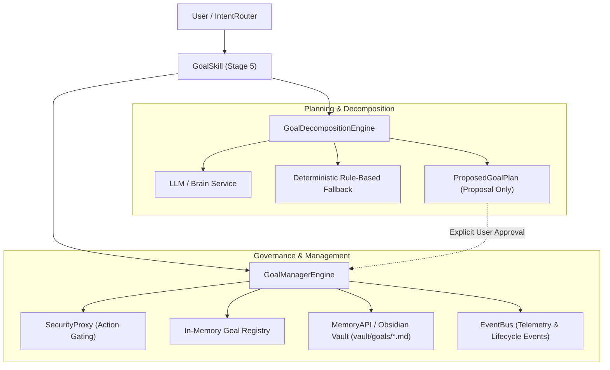

# JARVIS X — Goal Management System Architecture

## Overview

The Goal Management System (Stage 4) equips JARVIS X with hierarchical goal tracking, natural-language goal decomposition, persistent lifecycle management, and explicit security governance. It guarantees that multi-step, long-term objectives are broken down into actionable subgoals and tasks with deterministic progress tracking without executing tasks autonomously.

---

## 1. System Architecture



---

## 2. Storage Source of Truth & Persistence Semantics

### Authoritative Store
- **Obsidian Vault Directory (`vault/goals/<goal_id>.md`)**: The Markdown Vault managed via `MemoryAPI` serves as the authoritative, human-readable, and cross-platform source of truth.
- **No Extra Databases**: Consistent with JARVIS architectural guidelines, no new SQLite databases or external stores are introduced.

### File Format & Dual-Fidelity Layout
Each goal note is saved with:
1. **YAML Frontmatter**: Standard Obsidian metadata for tags, IDs, statuses, and target dates.
2. **Markdown Body**: Formatted description, checklist of tasks, and subgoals.
3. **Structured Embedded JSON Block**: A ````json ``` code block at the base of the file encapsulating the raw JSON dictionary serialization of the `Goal` domain model. This ensures 100% roundtrip fidelity across system restarts without losing nested task identifiers, custom metadata, or ISO timestamp precision.

### Recovery & Boot Semantics
- At initialization, `GoalManagerEngine.load_from_storage()` scans `vault/goals/` via `MemoryAPI.list_notes("goals")`.
- It reconstitutes each note by parsing the embedded JSON block (or YAML frontmatter fallback if missing) into validated `Goal` models.
- Missing or malformed notes log warnings and are skipped without crashing the engine.

---

## 3. Domain Models & Lifecycle Transitions

### Enums
- **`GoalType`**: `SHORT_TERM`, `MEDIUM_TERM`, `LONG_TERM`.
- **`GoalStatus`**: `PROPOSED`, `ACTIVE`, `PAUSED`, `COMPLETED`, `CANCELLED`.

### State Machine Transition Rules
Transitions strictly enforce the lifecycle state machine:
- `PROPOSED` -> `ACTIVE`, `CANCELLED`
- `ACTIVE` -> `PAUSED`, `COMPLETED`, `CANCELLED`
- `PAUSED` -> `ACTIVE`, `CANCELLED`
- `COMPLETED` -> `ACTIVE` (reopening recalculates progress and retains audit metadata)
- `CANCELLED` -> Terminal (cannot transition directly to `COMPLETED`)

### Hierarchy & Integrity
- **Cycle Prevention**: Prior to committing parent-child links in `add_subgoal()`, `validate_hierarchy_acyclic()` traverses the tree via depth-first search. If a cycle or inconsistent link is detected, pointers are rolled back and a `ValueError` is raised.
- **Cancellation Policy**: Cancelling a parent goal by default preserves child goals (detaching their parent references), or optionally cascades cancellation if `cascade_children=True` is explicitly specified.
- **Completion Safeguards**: Progress reaching `1.0` (100%) does NOT automatically complete a goal; explicit user or workflow confirmation is required.

---

## 4. Progress Roll-Up Semantics

Progress calculation conforms to Stage 2 mathematical specifications:
- **Empty Goals (no tasks, no subgoals)**: `0.0`.
- **Tasks Only**:
  `completed_tasks / total_tasks`
- **Subgoals Only**:
  arithmetic mean of child subgoal progress
- **Mixed (both tasks and subgoals)**:
  `0.5 * (completed_tasks / total_tasks) + 0.5 * (mean_subgoal_progress)`

---

## 5. Proposal & Approval Integration

1. `GoalDecompositionEngine` generates a non-active `ProposedGoalPlan`.
2. Plans with unresolved mandatory clarification questions cannot be approved (`is_blocked` evaluates to `True`).
3. Approving a proposal (`save_approved_plan`) persists the main goal and child subgoals as `ACTIVE` goals in storage.
4. **Safety Rule**: Approval activates the goal structure only—it **never** authorizes task execution.
5. Re-approving an already saved or rejected proposal raises a `ValueError` to prevent duplicate writes.

---

## 6. Security Boundaries

- Any state-mutating operation (`create_goal`, `update_goal`, `complete_goal`, `cancel_goal`, `add_subgoal`, `remove_subgoal`, `save_approved_plan`) checks permissions via `SecurityProxy.authorize_action("manage_goals", details)`.
- If `SecurityProxy` denies authorization, a `PermissionError` is raised before any in-memory state or storage file is modified, guaranteeing zero partial writes.

---

## 7. EventBus Integration

Supported events are published when state changes occur:
- `goal.created`
- `goal.updated`
- `goal.status_changed`
- `goal.subgoal_added`
- `goal.subgoal_removed`
- `goal.completed`
- `goal.cancelled`
- `goal.plan_saved`

Failures in the event publisher are caught and logged, preventing telemetry issues from corrupting persisted goal state.
