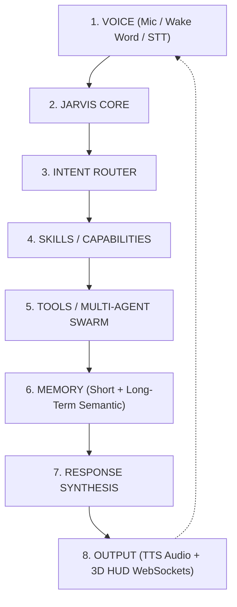
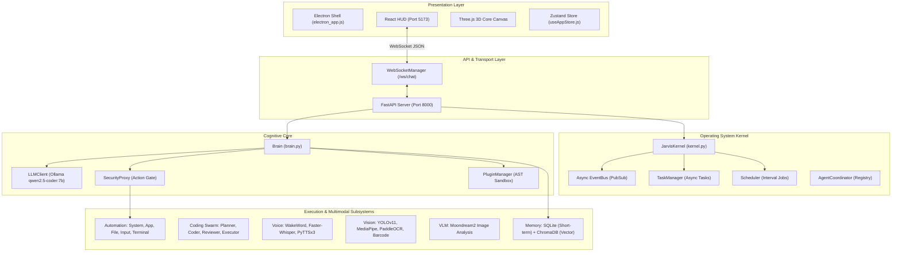
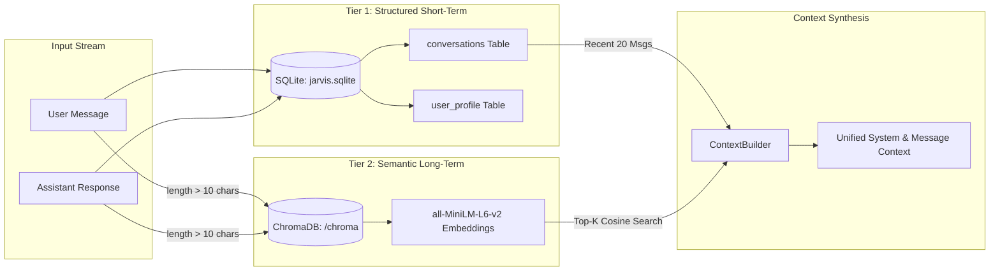
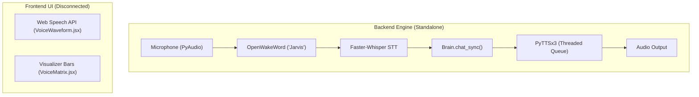
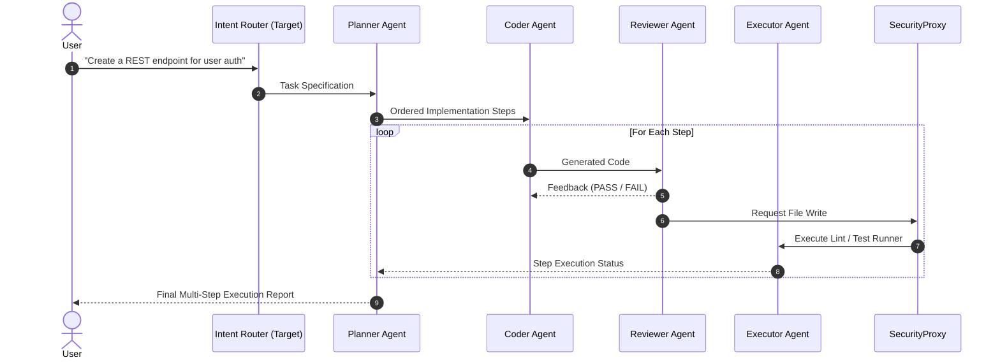

# JARVIS X OS — Master Repository Architectural Audit

**Document Version:** 1.0  
**Audit Date:** September 3, 2026  
**Auditor:** Antigravity AI  
**Scope:** Complete inspection of backend, frontend, desktop, kernel, agents, automation, voice, vision, VLM, memory, plugins, scheduler, WebSocket layer, configuration, startup scripts, tests, and documentation.

---

## Executive Summary & Product Philosophy Alignment

The existing repository is an operational prototype of **JARVIS X**, combining local LLM execution (Ollama), multi-modal perception (YOLO, MediaPipe, PaddleOCR, Moondream2), desktop automation (PyAutoGUI, PyCAW, PSUtil), multi-agent coding (Planner/Coder/Reviewer/Executor), and a futuristic HUD (React + Three.js + Electron).

### Target Reference Philosophy:
$$\text{Speak} \longrightarrow \text{Route} \longrightarrow \text{Execute} \longrightarrow \text{Remember} \longrightarrow \text{Repeat}$$

### Target Architectural Pipeline:

---

## 1. Current Architecture

### Key Structural Characteristics:
1. **Entry Point (`backend/main.py`)**: Initializes `Brain` and `JarvisKernel`, injects them into `server.py`, and launches Uvicorn on port `8000`.
2. **Orchestrator (`backend/brain.py`)**: Monolithic coordinator handling user prompts, string-based `[TOOL]` parsing, tool dispatching through `SecurityProxy`, and Ollama streaming.
3. **Kernel (`backend/kernel/kernel.py`)**: Asynchronous engine featuring an `EventBus`, background `TaskManager`, interval `Scheduler`, and `AgentCoordinator`. Currently used primarily to periodically broadcast CPU/RAM telemetry.
4. **Presentation (`frontend/`)**: React 19 single-page application rendering an Iron Man HUD with Three.js visualization, real-time gauges, telemetry, and WebSocket chat.
5. **Desktop (`electron_app.js`)**: Frameless, transparent floating Electron shell with global shortcut `Alt+Space`.

---

## 2. Existing Working Features

| Feature Subsystem | Component Files | Current Status & Capabilities |
| :--- | :--- | :--- |
| **Local LLM Engine** | `backend/llm_client.py` | Working. Streams chat chunks from Ollama API (`qwen2.5-coder:7b`). Supports sync and stream modes. |
| **Database & Memory** | `backend/memory/database/sqlite_manager.py`, `backend/memory/embeddings/chroma_manager.py`, `backend/memory/retrieval/context_builder.py` | Working. Stores session messages and user preferences in SQLite; vector semantic search via ChromaDB cosine embeddings; context builder merges history + semantic recall. |
| **OS Automation** | `backend/automation/*` (`app_manager.py`, `file_manager.py`, `input_controller.py`, `system_controller.py`, `terminal_executor.py`) | Working. Windows app launching, process listing/killing, volume/brightness/battery queries, mouse/keyboard control, screenshotting, file search/CRUD, and PowerShell execution. |
| **Security Proxy** | `backend/automation/security_proxy.py` | Working. Classification of actions into `SAFE_ACTIONS` vs `DANGEROUS_ACTIONS`, logging to `logs/automation_audit.log`, and blocking unregistered commands. |
| **Plugin Framework** | `backend/plugins/*`, `plugins/hello_world/` | Working. Dynamic directory discovery, JSON manifest parsing, AST static analysis (`PluginSandbox`), dynamic import, and tool execution. |
| **Multi-Agent Coding** | `backend/agents/*` (`planner.py`, `coder.py`, `reviewer.py`, `executor.py`, `code_tools.py`) | Working. Step decomposition (`STEP N: CREATE/MODIFY`), code generation, automated review formatting (`VERDICT: PASS/FAIL`), pytest/jest test execution, and repo tree generation. |
| **Vision AI** | `backend/vision/*` | Working. YOLOv11 object bounding, MediaPipe face detection and hand tracking, PaddleOCR text extraction, and PyZbar barcode decoding. |
| **VLM Scene Cognition** | `backend/vlm/*` | Working. Moondream2 model integration for visual QA, screen analysis, webcam capture, and base64 image compression. |
| **Voice Engine** | `backend/voice/*` | Working standalone. OpenWakeWord detection loop, Faster-Whisper offline transcription, and PyTTSx3 threaded speech queue. |
| **Web HUD** | `frontend/src/*` | Working. Real-time telemetry widgets, Three.js 3D rotating reactor core, animated status bars, sound matrix animations, and WebSocket chat stream rendering. |

---

## 3. Incomplete Features & Subsystem Disconnections

1. **Voice Pipeline Disconnected from API/HUD**:
   - `backend/voice/voice_manager.py` is fully implemented but is never instantiated or started by `backend/main.py` or `start_jarvis.py`.
   - The React frontend has a separate browser-based Web Speech API component (`VoiceWaveform.jsx`) and a standalone animated widget (`VoiceMatrix.jsx`) that are disconnected from the Python backend Whisper/WakeWord engine.
2. **Vision Pipeline Disconnected from Web Dashboard**:
   - `backend/vision/vision_manager.py` uses `cv2.imshow` in a local desktop loop. It does not stream video frames over WebSockets to `frontend/src/components/VisionPreview.jsx`.
3. **VLM Pipeline Not Exposed as a Tool**:
   - `backend/vlm/vlm_manager.py` is not wired into `backend/brain.py`'s tool dispatcher, meaning the AI brain cannot autonomously decide to take a screenshot and analyze it via VLM.
4. **Coding Agent Swarm Not Exposed to Brain or Kernel**:
   - `backend/agents/agent_manager.py` is tested in isolation but has no route or tool definition in `Brain` or `JarvisKernel`.
5. **Kernel Event Bus Unused by Cognitive Loop**:
   - `JarvisKernel._handle_user_input` receives user inputs and publishes `brain_process_request`, but nothing subscribes to this event; `Brain.chat_stream` is invoked directly by `server.py`.
6. **Memory Deletion / Soft Clear Stubbed**:
   - `MemoryManager.clear_memory()` is a stub that logs a message without executing cleanup.
7. **Documentation Stubs**:
   - `docs/docs/api/Dispatcher.md` is a 0-byte empty file.

---

## 4. Duplicate Functionality

1. **Dual Electron Implementations**:
   - Root `electron_app.js`: Clean frameless window loader used by `start_jarvis.py`.
   - Subdirectory `desktop/`: Separate Electron Forge project with duplicate `package.json`, `node_modules`, and boilerplate Vite configs.
2. **Duplicated Frontend Components (Two Divergent HUD Designs)**:
   - `frontend/src/components/AgentPanel.jsx` vs `frontend/src/components/panels/AgentMonitor.jsx`
   - `frontend/src/components/ChatPanel.jsx` vs `frontend/src/components/panels/ChatConsole.jsx`
   - `frontend/src/components/SecurityLog.jsx` vs `frontend/src/components/panels/SecurityLog.jsx`
   - `frontend/src/components/TelemetryPanel.jsx` vs `frontend/src/components/panels/TelemetryPanel.jsx`
   - `frontend/src/components/3d/AICore.jsx` (Red/Gold Iron Man Core) vs `frontend/src/components/3d/Jarvis3DCore.jsx` (Cyan/Blue Hologram Core)
   - `frontend/src/components/VoiceWaveform.jsx` vs `frontend/src/components/panels/VoiceMatrix.jsx`
3. **Duplicate Screenshot Tools**:
   - `backend/automation/input_controller.py:screenshot()` vs `backend/vlm/image_utils.py:capture_screenshot()`.

---

## 5. Dead / Unused Code

1. **Unused Frontend Components**:
   - `frontend/src/components/CommandCenter.jsx`: Full keyboard-driven command palette (Ctrl+K) with quick actions, never imported in `App.jsx`.
   - `frontend/src/components/Header.jsx`: Full holographic HUD header bar, never rendered.
   - `frontend/src/components/VisionPreview.jsx`: Holographic vision matrix preview with reticle animations, never rendered.
   - `frontend/src/components/3d/Jarvis3DCore.jsx`: High-quality Three.js particle system with mouse tracking, replaced by `AICore.jsx`.
2. **Unused Backend Modules & Methods**:
   - `backend/kernel/agent_coordinator.py:broadcast_state()`: Uninvoked method.
   - `backend/agents/code_tools.py:extract_imports()`, `git_log()`: Implemented but uncalled helper utilities.
   - `desktop/src/*`: The entire Electron Forge renderer pipeline is bypassed by the root script.

---

## 6. Broken Imports & Code Issues

1. **Infinite Loop in Test Suite**:
   - In `tests/test_vision.py`, `TestVisionManager.test_processing_pipeline` mocks `cv2` via `sys.modules['cv2'] = MagicMock()`.
   - In `backend/vision/vision_manager.py`, `_process_loop` checks `cv2.waitKey(1) & 0xFF == ord('q')`.
   - Bitwise AND on `MagicMock()` returns another `MagicMock`, which evaluates as not equal to `ord('q')`, preventing loop exit and causing `python -m unittest discover tests` to hang indefinitely.
2. **Terminal Input Blocking in Server Mode**:
   - `backend/automation/security_proxy.py:request_confirmation()` calls Python's built-in `input()`. When running as a background service or under Uvicorn, this blocks the entire process or raises `EOFError`.
3. **FastAPI Deprecated Lifecycle Handlers**:
   - `backend/api/server.py` uses `@app.on_event("startup")` and `@app.on_event("shutdown")` instead of modern FastAPI `lifespan` context managers.

---

## 7. Configuration Inconsistencies

1. **LLM Model Name Drift**:
   - `configs/config.json` specifies `"model": "qwen2.5-coder:7b"`.
   - `backend/llm_client.py` defaults to `"model": "qwen:4b"`.
   - `README.md` references `ollama pull qwen`.
2. **Memory Configuration Discrepancies**:
   - `configs/config.json` has `memory.max_context_messages: 20`, but `backend/memory/database/sqlite_manager.py` uses a hardcoded default of `limit=20` and `backend/memory/retrieval/context_builder.py` only reads `retrieval_top_k: 3`.
3. **Voice Engine Settings**:
   - `configs/config.json` lists `energy_threshold`, `dynamic_energy_threshold`, and `pause_threshold`, but lacks output audio device settings, TTS voice ID, pitch, or speech rate.

---

## 8. Security Issues

| Severity | Issue | File Location | Description & Impact |
| :--- | :--- | :--- | :--- |
| **HIGH** | Shell Injection Risk | `backend/automation/app_manager.py:45` | `subprocess.Popen(command, shell=True)` executes raw user-provided strings when the application is not matched in the registry. |
| **HIGH** | Electron Node Integration | `electron_app.js:16-17` | `nodeIntegration: true, contextIsolation: false` exposes direct Node.js system calls to the renderer window. |
| **MEDIUM** | Synchronous STDIN Confirmation | `backend/automation/security_proxy.py:50` | `input()` prompt blocks backend event processing for dangerous tools; needs async WebSocket confirmation handshake with HUD. |
| **MEDIUM** | AST Sandbox Reflection Bypass | `backend/plugins/plugin_sandbox.py` | AST blacklist can be bypassed through Python reflection (`__subclasses__`, `getattr`). |
| **LOW** | Open CORS Policy | `backend/api/server.py:18` | `allow_origins=["*"]` allows any web page to communicate with the local Jarvis API when running. |

---

## 9. Memory Architecture

### Assessment:
- **Strengths**: Clean separation of short-term relational dialogue in SQLite and long-term vector embeddings in ChromaDB.
- **Deficiencies**:
  - No summarization or memory compression pipeline for long dialogues.
  - No episodic entity extraction (e.g., storing facts about user's preferences, projects, or credentials in a structured knowledge graph).
  - Fixed length cutoff (`> 10` chars) discards important short commands (e.g., "Remember my name is Sam").

---

## 10. Voice Architecture

### Assessment:
- **Strengths**: Fully local, zero-cloud dependencies, utilizing low-latency faster-whisper and openwakeword.
- **Deficiencies**:
  - The backend voice loop is not launched during main application boot.
  - Cannot interrupt (barge-in) while PyTTSx3 is actively speaking.
  - Frontend UI visualizer is not bound to actual audio amplitude levels from backend PyAudio.

---

## 11. Agent Architecture

### Assessment:
- **Strengths**: Clean 4-stage coding agent pipeline (`Planner -> Coder -> Reviewer -> Executor`) with language-specific test runners and linters.
- **Deficiencies**:
  - The coding pipeline is decoupled from the main `Brain` conversational interface.
  - No Intent Router to dynamically decide whether a request is a simple conversation, PC automation command, coding task, or visual query.
  - Kernel's `AgentCoordinator` registry is empty and unutilized.

---

## 12. Frontend Architecture

- **Framework**: React 19, Vite 8, Zustand 5, Three.js, Lucide Icons.
- **Current Layout (`frontend/src/App.jsx`)**:
  - **Left**: Uptime clock, CPU/RAM swap telemetry.
  - **Center**: 3D Wireframe Reactor Core (`AICore.jsx`), Quick Action buttons, Chat Console (`ChatConsole.jsx`).
  - **Right**: Temperature gauges (`TempGauge.jsx`), GPU/VRAM bars (`Bar.jsx`), Network widget, Agent monitor, Voice matrix visualizer, Security log.
- **State Management (`useAppStore.js`)**:
  - Manages `isConnected`, `aiStatus` (`IDLE`, `THINKING`, `SPEAKING`), `stats`, `messages` array, and streaming chunks.
- **Aesthetic Assessment**:
  - High-impact Iron Man HUD visual style with scanline overlays, CRT vignettes, and red/gold/cyan color harmony.
  - Needs consolidation of unused components (`CommandCenter.jsx`, `VisionPreview.jsx`, `Header.jsx`) into the active HUD interface.

---

## 13. Desktop Architecture

- **Current Implementation**:
  - Root `electron_app.js` initializes a 1200x800 frameless window loading `http://localhost:5173`.
  - Global hotkey `Alt+Space` toggles window visibility (show/hide overlay).
- **Redundancies to Clean**:
  - The `desktop/` directory contains an unlinked Electron Forge template that duplicates dependencies.
  - Consolidating configuration into a single clean Electron runner while hardening `webPreferences` (`contextIsolation: true`, secure preload IPC bridge) will eliminate security vulnerabilities.

---

## 14. Startup / Runtime Problems

1. **Process Orchestration in `start_jarvis.py`**:
   - `start_jarvis.py` executes `npm run dev`, `npm run electron`, and `python backend/main.py`.
   - Starts Electron before verifying Vite dev server has bound to port `5173`.
   - If Ollama is offline on port `11434`, the script exits abruptly without an auto-start attempt or user-friendly fallback.
2. **WebSocket Broadcast Bottleneck**:
   - `WebSocketManager.broadcast` pushes every chunk to all connected clients indiscriminately rather than supporting session-bound connection pools.

---

## 15. Testing Gaps

1. **Hanging Tests**: `tests/test_vision.py` hangs due to `cv2.waitKey` mock evaluation.
2. **Coverage Gaps**:
   - No tests for `backend/main.py` CLI vs Web server branching.
   - No integration test for WebSocket streaming under concurrent loads.
   - No automated tests for the frontend UI components (Playwright test suite not yet configured).
   - No automated tests for real VLM endpoint inference.

---

## 16. Dependency Problems

1. **Python Dependencies (`requirements.txt`)**:
   - `paddlepaddle-gpu`: Fails to build/install on systems without dedicated CUDA runtime. Should be optional or fall back to CPU `paddlepaddle`.
   - Dependencies are unpinned (no versions specified), creating vulnerability to breaking upstream releases.
2. **Node Dependencies**:
   - Duplicate `package.json` in `desktop/` and `frontend/`.
   - React 19 with `@react-three/fiber` (v9.6.1) requires strict peer dependency compatibility.

---

## Comparison: Current Implementation vs. Target OS Architecture

| Target OS Stage | Target Specification Requirement | Current Repository State | Gap & Evolution Requirement |
| :--- | :--- | :--- | :--- |
| **1. VOICE** | Wake word detection $\rightarrow$ Streaming STT with dynamic energy thresholding & interrupt support. | Standalone `WakeWordDetector` + `SpeechToText`. | Wire backend voice manager into the kernel lifecycle and link live audio waveform to the HUD. |
| **2. JARVIS CORE** | Central asynchronous OS kernel orchestrating all event streams, task queues, and services. | `JarvisKernel` exists with `EventBus` and `TaskManager`, but is only used for telemetry. | Promote `JarvisKernel` to the primary runtime controller that owns the Brain, Voice, and Vision subsystems. |
| **3. INTENT ROUTER** | High-speed classification of user inputs into: Conversational, PC Action, Code Synthesis, Visual QA, or Plugin. | Prompt-based parsing in `Brain` (`[TOOL]` strings). | Implement a dedicated Intent Classifier / Router that directs requests to specialized handlers before LLM generation. |
| **4. SKILLS / CAPABILITIES** | Structured skill modules with declarative parameters and permission levels. | Low-level automation methods in `backend/automation/`. | Wrap automation tools, vision tools, and VLM into formal Skill descriptors with JSON schema validation. |
| **5. TOOLS / AGENTS** | Multi-agent execution swarms (Planner, Coder, Reviewer, Executor) running in sandboxed tasks. | `backend/agents/agent_manager.py` exists but is isolated. | Register the Coding Agent Swarm into the Kernel's `AgentCoordinator` and expose it to the Intent Router. |
| **6. MEMORY** | Unified Short-Term + Semantic Vector + Long-Term Entity Knowledge Graph. | SQLite + ChromaDB with basic context builder. | Implement entity extraction, structured user memory, and clean context window management. |
| **7. RESPONSE SYNTHESIS** | Structured JSON streaming with concurrent text, status indicators, and tool result payloads. | Raw text stream with appended tool results. | Standardize WebSocket protocol to stream typed payloads (`token`, `tool_call`, `tool_result`, `agent_state`). |
| **8. TTS + HUD** | Real-time audio synthesis with synchronized speech + Iron Man HUD updates + Floating Desktop overlay. | Working Three.js HUD + standalone PyTTSx3. | Connect TTS playback with visualizer state and command palette (Ctrl+K) in HUD. |

---

## Recommended Next Steps (Phase Roadmap Preview)

1. **Phase 1 — Core Kernel & Router Unification**: Unify `Brain`, `JarvisKernel`, and `EventBus`. Introduce an `IntentRouter` to dispatch incoming user requests to the appropriate subsystem.
2. **Phase 2 — Multimodal & Agent Subsystem Wiring**: Wire `VoiceManager`, `VisionManager`, `VLMManager`, and `AgentManager` into the Kernel and register them as callable tools.
3. **Phase 3 — HUD & WebSocket Protocol Upgrade**: Unify redundant frontend components, connect the Command Palette (Ctrl+K) and Vision feed, and standardize the WebSocket event protocol.
4. **Phase 4 — Desktop & Security Hardening**: Harden Electron IPC (`contextIsolation`, preload bridge), replace terminal `input()` with async HUD confirmation dialogs, and eliminate duplicate `desktop/` directory.
5. **Phase 5 — Test Suite & Dependency Optimization**: Fix `test_vision.py` loop, pin dependencies, make GPU packages optional, and verify end-to-end Speak $\rightarrow$ Route $\rightarrow$ Execute $\rightarrow$ Remember flow.

---
*End of Architectural Audit Report.*
