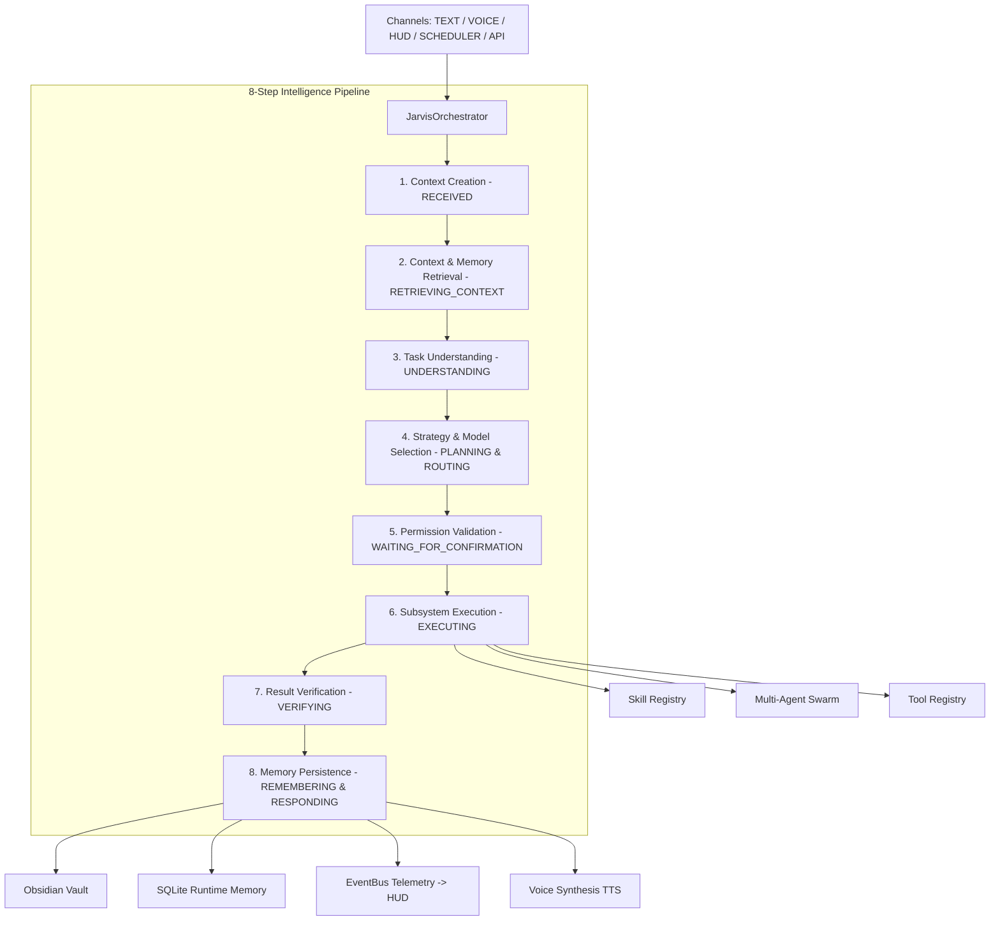

# JARVIS Intelligence Orchestrator (Core v2.0)

> **"Highest-Level Intelligence Coordination Layer for JARVIS OS"**

The **JARVIS Intelligence Orchestrator** (`JarvisOrchestrator`) is the central cognitive control plane responsible for evaluating, classifying, routing, coordinating, and verifying every request entering JARVIS OS across Text, Voice, HUD, Scheduler, and API sources.

---

## 🏛️ Architecture & System Hierarchy

$$\text{INGESTION CHANNELS} \longrightarrow \text{JARVIS ORCHESTRATOR} \longrightarrow \begin{cases} \text{Context Analysis} \\ \text{Memory Retrieval} \\ \text{Decision Engine (Strategy \& Model Selection)} \\ \text{Security Proxy (4-Tier Permission Gate)} \\ \text{Execution (Skills / Agents / Tools)} \\ \text{Result Verification} \\ \text{Memory Persistence (Obsidian Vault + SQLite)} \end{cases} \longrightarrow \text{TTS / HUD STREAM}$$



---

## 🔄 8-Step Request Lifecycle

1. **Context Creation (`RECEIVED`)**:
   - Initializes a unified `ExecutionContext` capturing `request_id`, ingestion `source` (`TEXT`, `VOICE`, `HUD`, `SCHEDULED`, `API`), session token, and timeout budget.
2. **Context & Memory Retrieval (`RETRIEVING_CONTEXT`)**:
   - Resolves intent with `IntentRouter`.
   - Queries `MemoryAPI` for semantic dialogue history or relevant Obsidian notes if required.
3. **Task Understanding & Classification (`UNDERSTANDING`)**:
   - `DecisionEngine.classify_task` categorizes the input into `TaskCategory`:
     - `CONVERSATION`, `QUESTION`, `COMMAND`, `RESEARCH_TASK`, `COMPUTER_ACTION`, `CODING_TASK`, `PLANNING_TASK`, `MEMORY_REQUEST`, `MULTI_STEP_TASK`, `SCHEDULED_TASK`.
4. **Strategy & Capability Selection (`PLANNING` & `ROUTING`)**:
   - Dynamic selection of execution strategy (`direct_skill`, `multi_agent`, `local_automation`, `research_pipeline`).
   - Fast-path execution for simple system queries (e.g. "What time is it?") with zero agent overhead.
   - Multi-agent swarm activation (`Planner` $\rightarrow$ `Coder` $\rightarrow$ `Reviewer` $\rightarrow$ `Executor`) for development tasks.
5. **Permission & Security Gate (`WAITING_FOR_CONFIRMATION`)**:
   - `SecurityProxy` evaluates required permission tier (`READ`, `WRITE`, `EXECUTE`, `DESTRUCTIVE`).
   - Destructive operations require explicit confirmation. If denied, the orchestrator halts immediately and transitions to `CANCELLED`.
6. **Execution (`EXECUTING`)**:
   - Dispatches task to the resolved skill (`SkillRegistry.execute_intent`) or multi-agent swarm (`AgentManager.run_task`) with timeout and cancellation tokens.
7. **Result Verification (`VERIFYING`)**:
   - Validates execution success, syntax linting, exit codes, and output integrity.
8. **Memory Persistence & Delivery (`REMEMBERING` $\rightarrow$ `RESPONDING` $\rightarrow$ `COMPLETED`)**:
   - Saves dialogue history, daily notes (`vault/daily/`), reports (`vault/outputs/`), and telemetry.
   - Dispatches structured events to the HUD via `EventBus` and synthesizes speech via `TTSProvider`.

---

## 📦 Unified `ExecutionContext`

```python
@dataclass
class ExecutionContext:
    request_id: str                          # Unique execution UUID
    source: InputChannel                     # TEXT, VOICE, HUD, SCHEDULED, API
    user_input: str                          # Raw input text
    session_id: str                          # Session identifier
    timestamp: float                         # Ingestion epoch timestamp
    
    conversation_context: List[Dict]         # Recent dialogue turns
    relevant_memory: List[Dict]              # Retrieved context snippets
    detected_intent: Optional[Intent]        # Classified intent
    task_category: TaskCategory              # 10 granular task categories
    
    selected_skill: Optional[str]            # Resolved skill target
    selected_model: Optional[str]            # "local:ollama" | "cloud:openai" | None
    selected_tools: List[str]                # Tool subsystems allocated
    selected_agents: List[str]               # Agent roles assigned
    execution_strategy: str                  # Execution path
    
    permission_level: str                    # READ | WRITE | EXECUTE | DESTRUCTIVE
    confirmation_required: bool              # True for destructive actions
    confirmation_granted: bool               # User confirmation status
    
    execution_status: ExecutionState         # Fine-grained state
    execution_history: List[Dict]            # Audit trail of pipeline steps
    result: Optional[Any]                    # Raw execution payload
    errors: List[JarvisError]                # Structured error stack
    needs_verification: bool                 # Post-execution verification flag
    should_save_memory: bool                 # Memory persistence flag
```

---

## 🚦 State Machine

```
   IDLE ──► RECEIVED ──► RETRIEVING_CONTEXT ──► UNDERSTANDING
                                                      │
   ┌──────────────────────────────────────────────────┘
   ▼
PLANNING ──► ROUTING ──► [ WAITING_FOR_CONFIRMATION ] ──► EXECUTING
                                │                            │
                                ▼                            ▼
                            CANCELLED                    VERIFYING
                                                             │
                                                             ▼
COMPLETED ◄── RESPONDING ◄── REMEMBERING (or FAILED) ◄───────┘
```

---

## 🛡️ Fault Tolerance & Error Handling

- **Missing / Failing Skills**: Gracefully caught without process crashing; returns actionable structured errors.
- **Offline LLM**: Fast-path fallback for deterministic commands; graceful reporting for complex conversational synthesis.
- **Cancellation**: Global `Escape` or `cancel()` signal halts running agents and subroutines immediately, cleanly transitioning state to `CANCELLED`.
- **Subprocess Timeouts**: Guarded execution ensures infinite loops or hung scripts abort safely after configurable timeout limits.

---

## 🔌 Extension Points

1. **Adding Custom Task Rules**: Extend pattern rules in `backend/orchestrator/decision_engine.py`.
2. **Adding New Skills**: Register skills in `SkillRegistry` or drop plugins in `plugins/`.
3. **Adding Custom LLM Providers**: Implement the `LLMProvider` interface in `backend/llm/providers/`.
