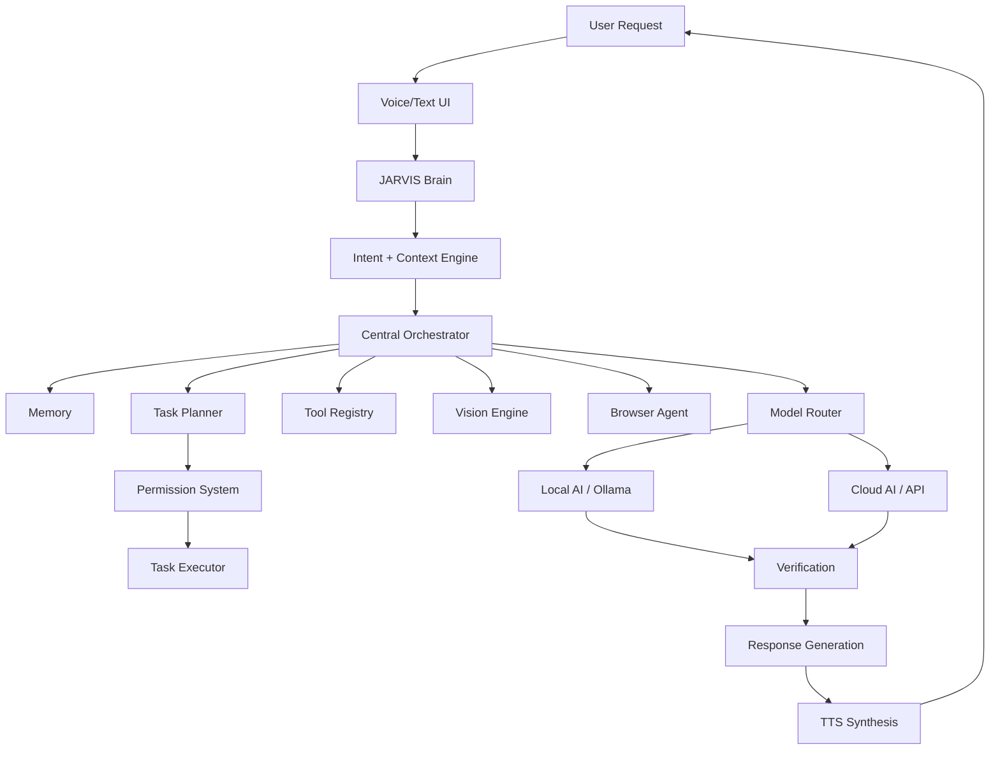

# JARVIS X - Final Architecture Report

## Overview
JARVIS X has transitioned from a conversational prototype into a fully unified, reliable **Hybrid AI Operating Environment**. It serves as a secure bridge between powerful intelligence (Local & Cloud AI) and native system execution (Desktop, Vision, Browser).

## Core Pipeline

## Architectural Hardening

### 1. The Unified Router
All redundant routing components have been merged. The `CentralRouter` handles command dispatch, while the `ModelRouter` purely handles the capability-driven selection of LLM models (Prompt 54).

### 2. Proactive Intelligence
The system operates a continuous background `ProactiveEngine` that monitors the event bus. It applies context-aware deduplication and quiet-mode filtering to ensure JARVIS observes passively but only interrupts when strictly necessary (Prompt 53).

### 3. Task Execution Engine
Tasks are securely decomposed and executed in isolation. A human-in-the-loop `SecurityProxy` blocks unapproved destructive actions, ensuring safe, constrained autonomy (Prompt 52).

### 4. Advanced Hybrid Networking
JARVIS defaults to Local AI. Cloud AI is utilized purely to satisfy required capabilities (like high-level reasoning or Vision) when privacy boundaries permit. Real `psutil` resource-awareness guarantees the kernel never crashes from OOM errors when loading models.

## Security Posture
JARVIS external output is treated as **untrusted data**.
- No `eval()` paths exist for LLM output.
- All secrets are filtered via `PrivacyBoundary`.
- Desktop interactions use strictly bounded OS endpoints rather than arbitrary shell execution.
