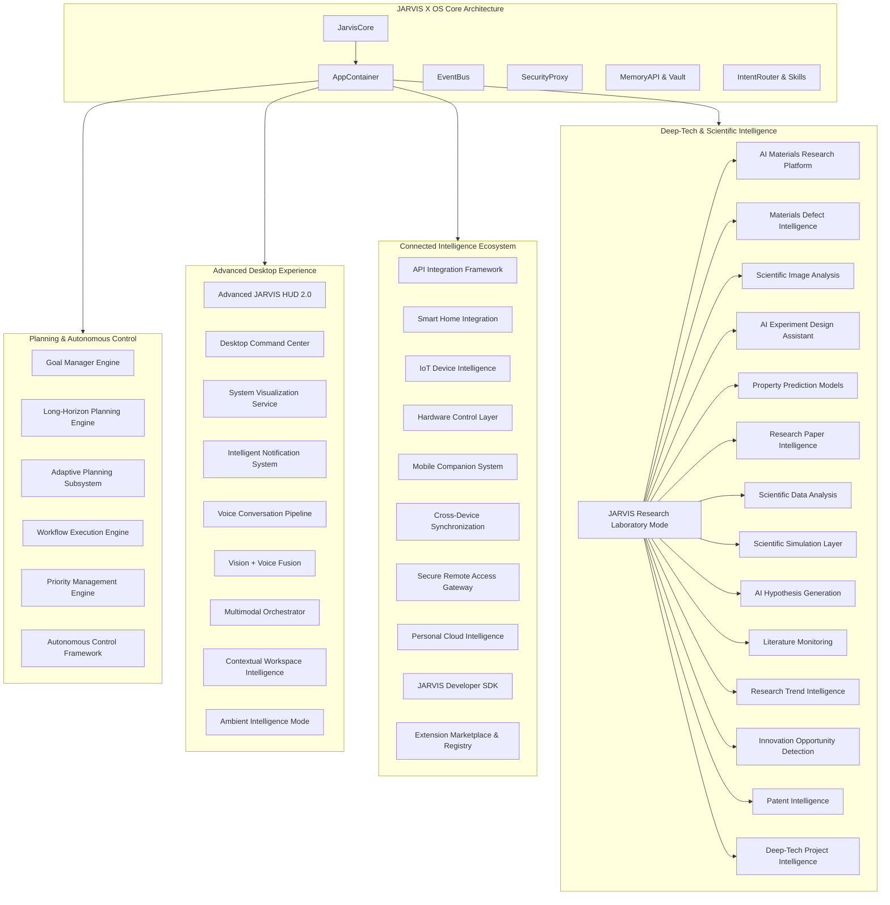

# JARVIS X OS — FINAL SYSTEM ARCHITECTURE
## Phases 1–7 Unified Architecture

### Complete Subsystem Integration
All 100 prompts across all 7 phases are unified through `AppContainer` and `JarvisCore` dependency injection, sharing centralized security proxies, permission scopes, event bus streaming, and human-in-the-loop approval gates.
