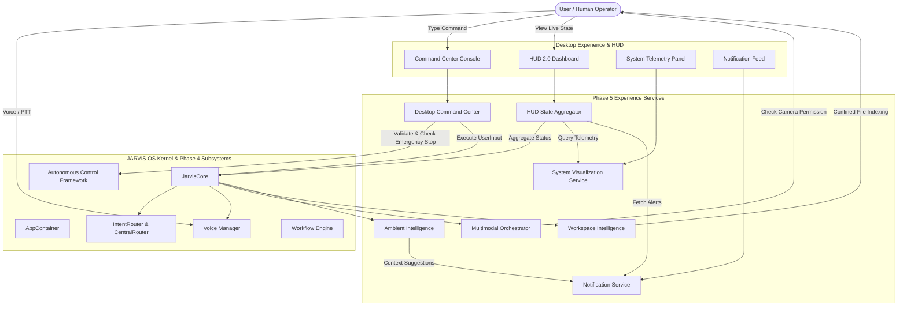

# PHASE 5 ARCHITECTURE SPECIFICATION
## ADVANCED JARVIS EXPERIENCE (PROMPTS 66–75)

### 1. Architectural Layers & Component Interactions

### 2. Service Responsibilities & Boundaries
1. **HUD 2.0**: Read-only state aggregation across all modules. If any subsystem is uninitialized or in an error state, it is recorded in `degraded_services` and does not throw exceptions.
2. **Command Center**: Strictly validates command input against dangerous shell execution (`rm -rf`, `del /s`, `format`, `eval`, `exec`). Checks the `AutonomousControlFramework` emergency stop state before dispatching.
3. **System Visualization**: Real-time bounded telemetry metrics using `psutil`. Bounded deques ensure zero memory accumulation. Transparently declares unavailable metrics.
4. **Notification Service**: Central routing of alerts with deduplication, quiet hours filtering, and unread management. Actions are non-authorizing.
5. **Multimodal Orchestrator**: Fuses audio transcripts and visual payloads into structured prompts. Enforces strict camera permission verification.
6. **Workspace Intelligence**: Scans and indexes local files strictly within authorized workspace roots. Rejects path traversal and auto-ignores `.env`, keys, and binary caches.
7. **Ambient Intelligence**: Opt-in ambient assistance. Default-disabled, zero keylogging, zero hidden camera/mic surveillance, schedule-bounded, and kill-switch enabled.
