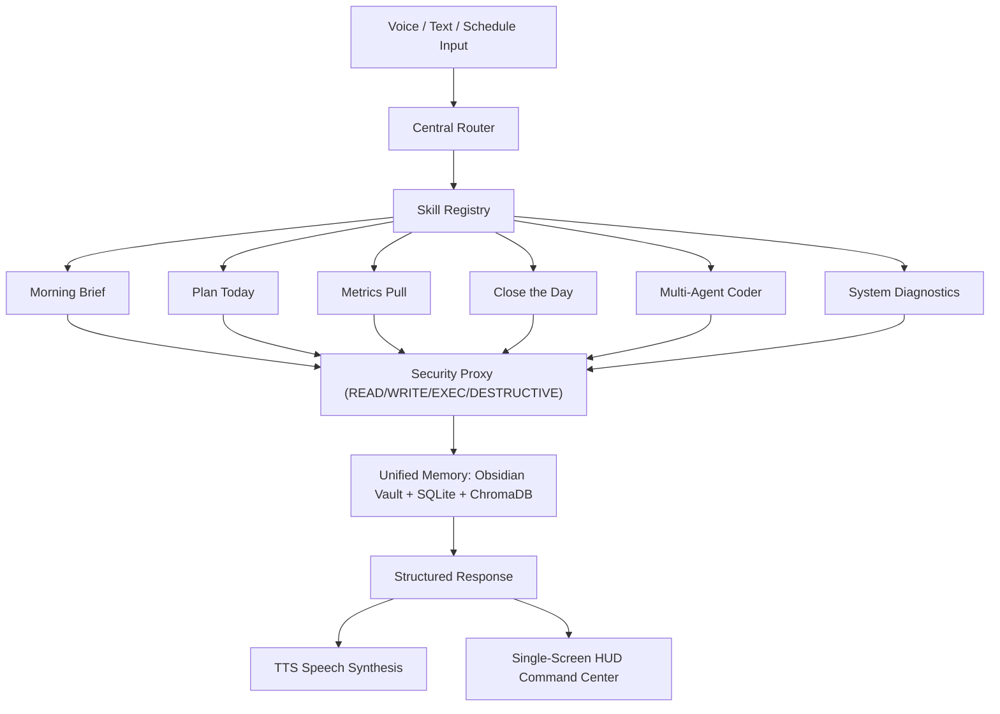

# JARVIS OS (Core v2.0)

> **"ONE VOICE. ONE WORKFLOW. ONE MEMORY. ONE SCREEN."**

JARVIS OS is a unified, provider-agnostic, autonomous AI Operating Layer built with Python, React, Three.js, and Electron. It transforms your desktop into an intelligent command center capable of voice interaction, multi-agent coding, Obsidian vault knowledge management, PC automation, and daily workflow execution.

---

## 🏛️ System Architecture

$$\text{VOICE / TEXT} \longrightarrow \text{CENTRAL ROUTER} \longrightarrow \text{SKILL REGISTRY} \longrightarrow \text{EXECUTION} \longrightarrow \text{MEMORY} \longrightarrow \text{TTS / HUD}$$



---

## ✨ Key Capabilities

1. **Single-Screen Command Center**:
   - Zero tabs, high information density dark terminal HUD (`#03060a`).
   - Live 3D Three.js holographic reactor matrix reflecting real-time voice and execution states.
   - Real-time hardware telemetry: CPU load, RAM GB/%, core temperatures, swap, network adapter.
   - Operating State Badges: `IDLE`, `RUNNING`, `SUCCESS`, `FAILED`, `CANCELLED`, `WAITING_FOR_CONFIRMATION`.

2. **Daily Operating Workflows**:
   - **`[07:00] MORNING BRIEF`**: Aggregates inbox, memory context, and git activity without fabricating data.
   - **`[09:00] PLAN TODAY`**: Pulls priorities, identifies top 3 actionable items, and writes directly to Obsidian `vault/daily/YYYY-MM-DD.md`.
   - **`[14:00] METRICS PULL`**: Captures live hardware telemetry snapshot to `vault/outputs/telemetry_snapshot.md`.
   - **`[19:00] CLOSE THE DAY`**: Summarizes completed daily tasks, captures daily reflection, and drafts tomorrow's top 3 priorities.

3. **Provider-Agnostic LLM Layer**:
   - Clean `LLMProvider` abstraction supporting local Ollama (`qwen2.5-coder:7b`), OpenAI-compatible REST endpoints, and offline mock modes.
   - Zero crashes when Ollama is offline.

4. **Obsidian Vault Knowledge Base**:
   - Obsidian-compatible Markdown vault structure: `vault/raw/`, `vault/wiki/`, `vault/outputs/`, and `vault/daily/`.
   - Automated backlinks scanner (`get_backlinks`), tags aggregator (`get_all_tags`), and path traversal guards.

5. **Multi-Agent Coding Engine**:
   - 4-stage pipeline: `Planner` $\rightarrow$ `Coder` $\rightarrow$ `Reviewer` $\rightarrow$ `Executor`.
   - Integrated timeout guards, clean cancellation (`Escape`), and output delivery into the Obsidian vault.

6. **Enterprise Security Proxy**:
   - 4-Tier Permission Matrix: `READ`, `WRITE`, `EXECUTE`, and `DESTRUCTIVE`.
   - Destructive operations (`delete_file`, `kill_process`, `system.shutdown`) require explicit user confirmation.
   - Automatic secret and API key redaction (`[REDACTED_API_KEY]`, `[REDACTED_TOKEN]`).
   - Structured JSONL security audit trail in `logs/security_audit.jsonl`.

---

## 🚀 Quickstart

### Prerequisites
- Python 3.10+
- Node.js 18+ and npm
- (Optional) [Ollama](https://ollama.ai) with `qwen2.5-coder:7b`

### 1. Install Dependencies
```bash
# Install Python backend requirements
pip install -r requirements.txt

# Install Frontend HUD dependencies
cd frontend
npm install
cd ..
```

### 2. Start JARVIS OS
Run the master boot script from the root directory:
```bash
python start_jarvis.py
```

- **Frontend HUD Command Center**: `http://localhost:5173`
- **Backend API Server**: `http://localhost:8000`
- **API Health Check**: `http://localhost:8000/health`

### Global Keyboard Shortcuts
- `Space`: Push-to-Talk (when not typing in text field)
- `Escape`: Instant operation cancellation
- `Enter`: Submit text command

---

## 🧪 Verification & Testing

Run the full automated test suite:
```bash
python -m unittest discover tests
```
*Current test pass rate: **160/160 tests passing (100%)**.*
